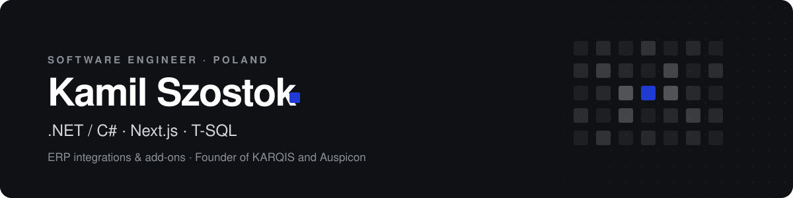

  

  &nbsp;
  &nbsp;
  

Software and AI / ML engineer. I build software that sits between business systems: integrations and add-ons for ERP, e-commerce and warehouse platforms, LLM-based automation on top of them, and the products behind two brands I run, **KARQIS** and **Auspicon**. Based in Bielsko-Biała, Poland.

Most of my day-to-day work is commercial and lives in private repositories under [KARQIS-PL](https://github.com/KARQIS-PL). What is public is here.

## What I do

<table>
  <tr>
    <th align="left" width="50%">ERP integrations</th>
    <th align="left" width="50%">ERP add-ons</th>
  </tr>
  <tr valign="top">
    <td>
      Two-way data flows between ERP, online stores, WMS, CRM and accounting: orders, stock levels, prices, documents.  
      REST APIs, webhooks, file exchange (XML / CSV / XLSX), direct database access when nothing else is available. Idempotent, logged, and safe to re-run.
    </td>
    <td>
      Extensions that live inside the ERP: importers, custom printouts and reports, validation rules, background jobs, UI plug-ins.  
      Built against vendor SDKs and COM / native APIs, with T-SQL doing the heavy lifting where it belongs.
    </td>
  </tr>
  <tr>
    <th align="left">AI / ML engineering</th>
    <th align="left">Products &amp; SaaS</th>
  </tr>
  <tr valign="top">
    <td>
      LLM features wired into real business processes: document and e-mail extraction, product data enrichment, review replies, classification and agent workflows with tool use.  
      Evaluation, prompt and context engineering, cost control. Claude, OpenAI and Gemini APIs, MCP servers and skills for coding agents.
    </td>
    <td>
      Off-the-shelf tools sold through the KARQIS store, licensing infrastructure, and Auspicon, a B2B SaaS built on Next.js that monitors how AI assistants talk about a business.  
      From first prototype through deployment and ongoing maintenance.
    </td>
  </tr>
</table>

## ERP systems I work with

| System | Typical work |
|---|---|
| **InsERT Subiekt nexo PRO** | Sfera / SDK add-ons, importers, reporting, database-level integrations |
| **Comarch ERP Optima** | COM API automation, custom SQL functions and printouts, integrations |
| **Comarch ERP XL** | XL API, Hydra add-ons, T-SQL procedures and triggers |
| **E-commerce &amp; WMS** | Store, marketplace and warehouse connectors: stock sync, order import, price lists |

## Stack

**Core**

  
  
  
  

**Also in daily use**

  
  
  
  
  
  
  
  
  

**AI / ML**

  
  
  
  
  
  
  

## Brands

<table>
  <tr valign="top">
    <td width="50%">
      
      <h3><a href="https://karqis.pl">KARQIS</a> &nbsp;karqis.pl</h3>
      
Software house and product store. Ready-to-buy tools for Polish businesses, such as the product importer for Subiekt nexo PRO, and custom work: ERP add-ons, ERP / WMS / e-commerce integrations and AI-assisted automation. Fixed scope and price agreed before work starts.

    </td>
    <td width="50%">
      <h3><a href="https://auspicon.com">Auspicon</a> &nbsp;auspicon.com</h3>
      
B2B SaaS for AI visibility. Tracks what ChatGPT, Gemini, Perplexity and Claude say about a business, drafts replies to Google reviews, and shows which AI bots crawl the company website. Weekly report, zero setup on the client side.

    </td>
  </tr>
</table>

## Open source

| Repository | What it is |
|---|---|
| [KARQIS-PL/karqis-skill-builder](https://github.com/KARQIS-PL/karqis-skill-builder) | Windows-first workbench for building, auditing and deploying coding-agent skills across Claude Code, Codex, Cursor and Windsurf. Electron + React + TypeScript, MIT. |
| [kamilsKQ/context_engineering](https://github.com/kamilsKQ/context_engineering) | A set of Markdown best-practice guides (API design, Git workflow, commenting, engineering principles) meant to be dropped into a codebase as shared context for AI coding agents. |

## Contact

Integration or ERP add-on in mind? The quickest route is the contact form at [karqis.pl](https://karqis.pl/kontakt). I reply in Polish or English.

Pixel accent borrowed from the KARQIS logotype.

